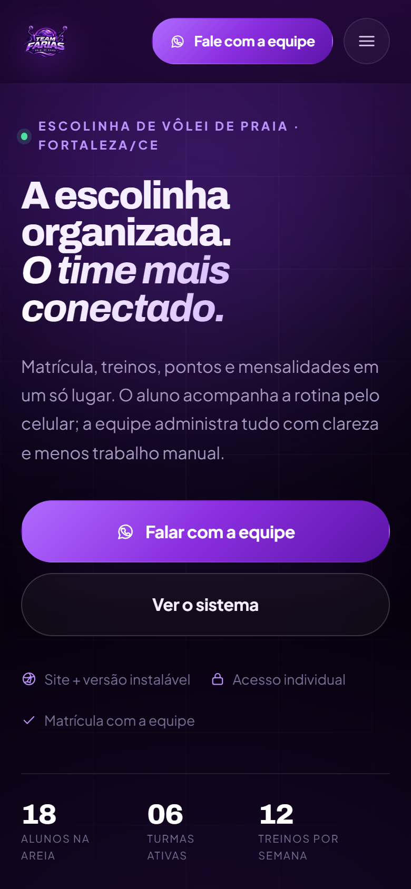
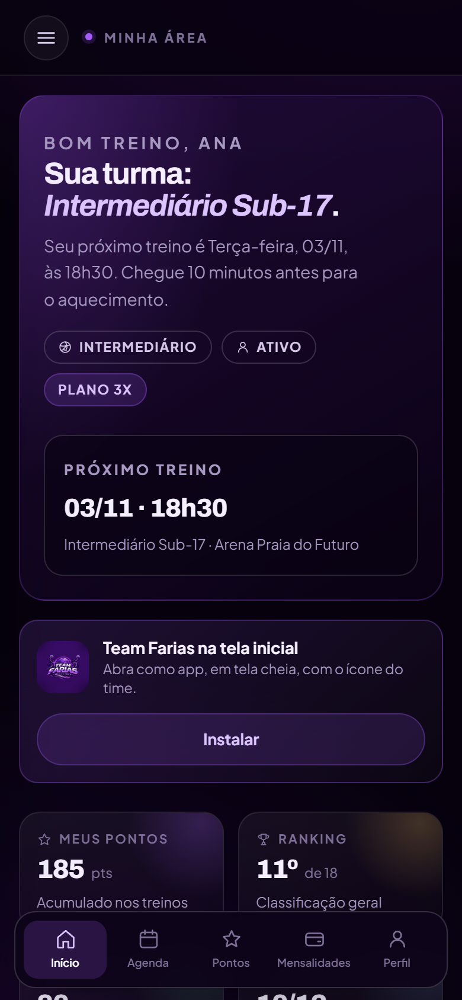
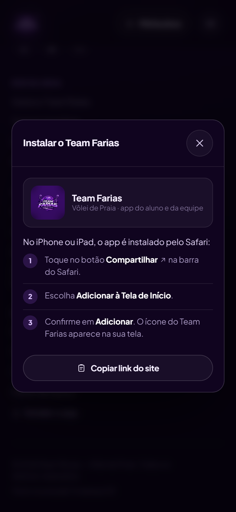
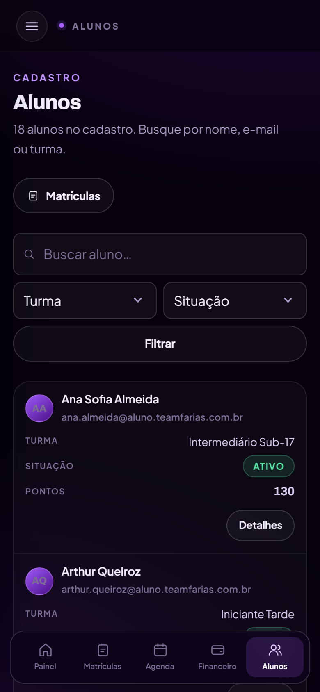

# Team Farias — Site + Sistema de Gestão

Plataforma web (site + área do aluno + painel da equipe) para a escolinha de vôlei de praia **Team Farias**, construída em **Python + Django** a partir da proposta comercial.

> A escolinha organizada. O time mais conectado.

---

## O que está pronto

Cada entrega da proposta foi implementada no código:

| Entrega da proposta | Onde está |
| --- | --- |
| Site responsivo, instalável (PWA) | `core` + `static/manifest.webmanifest` + `templates/core/sw.js` |
| Matrícula on-line com aprovação da equipe | `core/forms.py` (`EnrollmentForm`) e `dashboard/views.py` (`painel_enrollments`) |
| Área do aluno com login individual | `templates/app/*` e views `app_*` |
| Meu perfil, turma e matrícula | `templates/app/profile.html` |
| Pontos, histórico e ranking | `dashboard/services.py` (`ranking`) + `templates/app/points.html` |
| Calendário de treinos e presenças | `month_calendar` + `templates/app/agenda.html` |
| Mensalidades, status e histórico | app `billing` + `templates/app/invoices.html` |
| Notícias e recados | modelo `Announcement` (público, alunos, interno) |
| Painel da equipe com níveis de acesso | `dashboard/decorators.py` (`staff_required`, `team_required`, `student_required`) |
| Cadastro de alunos, responsáveis e turmas | apps `accounts` e `school` |
| Agenda de aulas e registro de presença | modelo `Session` / `Attendance` + `painel_attendance` |
| Lançamento de pontos com regras e histórico | `PointRule` / `PointEntry` |
| Controle de mensalidades com baixa administrativa | `Invoice` / `Payment` |
| Comunicados para alunos e responsáveis | `templates/painel/announcement_form.html` |
| Resumo gerencial | `templates/painel/home.html` e `templates/painel/reports.html` |

---

## Stack

- **Python 3.12** + **Django 5.2**
- **PostgreSQL** em desenvolvimento e produção, com psycopg 3
- Templates Django + CSS próprio (sem framework de UI) + **JavaScript vanilla**
- **HTMX 2** (self-hosted) para navegação, formulários e filtros sem recarregar a página
- **WhiteNoise** para arquivos estáticos em produção
- **PWA**: manifest, service worker, fallback offline, atalhos, splash screens e convite de instalação configurável
- Fontes self-hosted (Archivo + Plus Jakarta Sans) — o site não depende de CDN

---

## Como rodar

```bash
# 1. ambiente
python -m venv .venv
# Windows: .venv\Scripts\activate
# Linux/macOS: source .venv/bin/activate
pip install -r requirements.txt

# 2. configuração
copy .env.example .env      # Windows
cp .env.example .env        # Linux/macOS

# 3. banco PostgreSQL configurado no .env
python manage.py migrate
# Não carregue seed_demo em ambientes reais.

# 4. servidor
python manage.py runserver
```

Acesse **http://127.0.0.1:8000**.

> `seed_demo` é opcional e exclusivo de bancos descartáveis de desenvolvimento; gera uma senha aleatória por execução.

### Administração

Crie seu acesso local com `python manage.py createsuperuser`. Não há conta de produção predefinida.
Use `/painel/configuracoes/` para contatos, marca, textos e seções. Use `/painel/planos/` para os planos. Usuários, responsáveis,
locais e demais registros também podem ser gerenciados em `/admin/`, conforme as permissões.

---

## Acessos e permissões

| Área | Administração | Professor(a) | Aluno(a) |
| --- | --- | --- | --- |
| Site público e notícias | ✅ | ✅ | ✅ |
| Área do aluno | — | — | ✅ (somente os próprios dados) |
| Visão geral | ✅ (todas as turmas) | ✅ (somente suas turmas) | ❌ |
| Matrículas (criar e gerenciar) | ✅ | ❌ | ❌ |
| Alunos e fichas | ✅ | ✅ (suas turmas) | ❌ |
| Turmas | ✅ (criar/editar) | ✅ (consulta) | ❌ |
| Agenda e presença | ✅ | ✅ (suas turmas) | ❌ |
| Pontuação | ✅ | ✅ | ❌ |
| Financeiro | ✅ | ❌ | ❌ |
| Comunicados e relatórios | ✅ | ❌ | ❌ |

Regras aplicadas no servidor (`dashboard/decorators.py` e checagens nas views), não apenas no menu.

---

## Estrutura do projeto

```
teamfarias/            settings, urls, wsgi
core/                  site público, notícias, PWA
  management/commands/seed_demo.py
accounts/              User por e-mail, Student, Guardian
school/                turmas, horários, treinos, presença, pontos, comunicados
billing/               planos, mensalidades, pagamentos
dashboard/             área do aluno + painel da equipe
  services.py          ranking, métricas, geração de treinos e mensalidades
templates/             base pública, base do sistema, app/, painel/, partials/
static/
  css/app.css          design system + site
  css/dashboard.css    shell e componentes do sistema
  js/app.js            menu, toasts, reveal, PWA, copiar Pix
  js/dashboard.js      drawer, presença em lote, modal de pagamento
  img/                 logo tratada, ícones PWA, favicons
  fonts/               Archivo + Plus Jakarta Sans (woff2)
scripts/shoot.py       captura de telas para revisão visual
```

---

## Identidade visual

A paleta foi extraída do emblema enviado (violeta profundo, lavanda e quase-preto arroxeado):

| Token | Cor | Uso |
| --- | --- | --- |
| `--ink-950` | `#06010D` | fundo do site |
| `--violet-600` | `#8B2FE0` | cor base do emblema / botões |
| `--violet-500` | `#A45CFF` | destaques e ícones |
| `--violet-300` | `#DCC4FF` | textos de apoio sobre fundo escuro |
| `--text` | `#F5EFFF` | texto principal |

Arquivos em `static/img/`: `logo.png`, `logo.webp`, `logo-sm.webp`, ícones 192/512, máscara Android, apple-touch e favicons. O original está preservado em `assets/brand/logo-team-farias.png`.

---

## Rotas principais

| Rota | Descrição |
| --- | --- |
| `/` | Site institucional (hero, sistema, turmas, planos, notícias, contato) |
| `/matricula/` | Inscrição on-line com criação de acesso |
| `/noticias/` e `/noticias/<slug>/` | Notícias e comunicados públicos |
| `/entrar/` e `/sair/` | Login por e-mail / logout |
| `/app/` | Início do aluno |
| `/app/agenda/`, `/app/pontos/`, `/app/mensalidades/`, `/app/perfil/`, `/app/comunicados/` | Área do aluno |
| `/painel/` | Visão geral da equipe |
| `/painel/matriculas/`, `/painel/alunos/`, `/painel/turmas/` | Gestão de pessoas e turmas |
| `/painel/agenda/` | Agenda semanal + presença por treino |
| `/painel/pontos/` | Lançamento individual/coletivo + regras |
| `/painel/financeiro/` | Mensalidades, baixa e reabertura |
| `/painel/relatorios/` | Ocupação, assiduidade e receita |
| `/sw.js`, `/offline/` | Service worker e fallback offline |

---

## PWA e uso no celular

- `manifest.webmanifest` com ícones 192/512, ícone maskable, atalhos e capturas de tela.
- Ícone e splash screens do iPhone gerados com a logo; favicons **sem fundo**.
- Service worker na raiz (`Service-Worker-Allowed: /`): cache de estáticos, offline em `/offline/`; área logada e painel **nunca** são cacheados.
- **Convite de instalação configurável**, desativado por padrão; quando ativado aparece na primeira visita (some por 7 dias em “Agora não”), com instruções específicas para iPhone, Android e desktop.
- Layout com `env(safe-area-inset-*)`, alvos de toque maiores, campos de 16px (sem zoom no iOS) e tabelas em cartões.
- Em produção, **HTTPS** libera instalação completa no Android, cache offline e atualizações automáticas.

---

## Navegação sem recarregar (HTMX)

- `hx-boost` global no `<body>`: links internos, formulários, filtros, login, logout e ações do painel passam por AJAX.
- Barra de progresso no topo, View Transitions API (com respeito a `prefers-reduced-motion`) e troca de `<title>`/histórico automática.
- O `body` e o `<head>` são sincronizados a cada troca (classe do layout, `noindex`, descrição e canonical).
- Erros 403/404 são exibidos dentro da própria página; sem internet, mantém o formulário e informa o erro para uma nova tentativa.
- Os scripts usam delegação e reinicialização após cada swap (menus, toasts, modais, presença, abas e instalação).
- **Sidebar retrátil** no desktop: rail de 84px que expande para 272px no hover/foco e sobrepõe o conteúdo sem deslocar a página. No mobile, o mesmo menu abre como drawer pelo botão do topo, com backdrop e fechamento por Esc, toque fora ou ao navegar.

---

## Testes

```bash
python manage.py test
```

Testes cobrindo: páginas públicas, matrícula feita pela administração (duplicidade de e-mail, responsável, senha gerada, mensalidade automática), permissões por perfil, presença, pontuação individual/coletiva, baixa e reabertura de mensalidade, geração de cobranças, ranking, PWA e geração de treinos.

---

## Telas

| Celular (principal) | | |
| --- | --- | --- |
|  |  |  |
| Site institucional | Área do aluno | Painel da equipe |
|  |  |  |
| Instruções de instalação | Login | Alunos em cartões |

Desktop: [site](screenshots/site-desktop.png) · [painel](screenshots/painel.png) · [nova matrícula](screenshots/matricula-admin.png)

---

## Configuração e produção

O PostgreSQL é o banco padrão. Crie um banco e usuário dedicados, copie `.env.example` para `.env`
e informe `POSTGRES_DB`, `POSTGRES_USER`, `POSTGRES_PASSWORD`, `POSTGRES_HOST`, `POSTGRES_PORT`
e o modo TLS exigido pelo provedor (`POSTGRES_SSLMODE`). Credenciais nunca entram no Git.

```bash
pip install -r requirements.txt
python manage.py migrate
python manage.py createsuperuser
python manage.py collectstatic --noinput
python manage.py check --deploy
```

Em produção, defina `DJANGO_DEBUG=0`, chave `DJANGO_SECRET_KEY` exclusiva com pelo menos 50 caracteres,
`DJANGO_ALLOWED_HOSTS` e `DJANGO_CSRF_TRUSTED_ORIGINS` para o domínio real. Configure HTTPS no proxy
que sobrescreve `X-Forwarded-Proto`, sirva com Gunicorn e mantenha backups privados do PostgreSQL.
Não desative cookies seguros. A aplicação rejeita chave de desenvolvimento e SQLite em produção.

```bash
gunicorn teamfarias.wsgi:application --bind 127.0.0.1:8000 --workers 3
```

Dados demonstrativos são opcionais em um banco descartável de desenvolvimento; `seed_demo` é
bloqueado com `DEBUG=0`. Não importe o SQLite de demonstração para produção. Se houver dados reais
em uma instalação anterior, faça backup privado, valide a importação e confira contagens e vínculos
antes de trocar a conexão. As migrações não apagam matrículas nem cobranças.

### Configurações pelo painel

- Marca, logo por URL HTTPS e cor de destaque.
- WhatsApp, Instagram, telefone, e-mail opcional, cidade/UF e endereço confirmado.
- Título, descrição, texto sobre a escola, rodapé, chamada de contato e descrição para buscadores.
- Visibilidade de seções, contadores reais, próximo treino e convite de instalação.
- Idade mínima opcional e chave Pix restrita à área do aluno.
- Planos: nome, descrição, valor interno, vencimento, frequência e estado ativo. Alterações de preço valem para novas
  matrículas; os valores já combinados permanecem nas matrículas existentes.

O site apresenta um único plano, sempre com consulta pelo WhatsApp. Nenhum preço é publicado.
A migração mantém somente o primeiro plano ativo; outros planos permanecem no histórico das
matrículas e cobranças, inativos para novas adesões. A regra de um plano ativo é garantida no banco.

WhatsApp confirmado: 5588992671163. Instagram: teamfarias_. Localização: Tianguá/CE.
E-mail, endereço e Pix ficam vazios até serem informados pela administração.

### Privacidade e arquivos locais

HTML e páginas autenticadas não são armazenados no cache persistente do HTMX ou service worker.
O modo offline mantém apenas os arquivos estáticos e uma página genérica sem sessão.
Os nomes dos alunos e o ranking não são publicados na página inicial.

`.env`, `.local/`, bancos, backups, chaves, `ACESSOS.md` e `acessos-qr.png` são ignorados.
Os dois arquivos de acesso foram retirados do índice, sem excluir as cópias locais. Isso não remove
versões já presentes no histórico remoto: credenciais reais expostas anteriormente devem ser trocadas.
Nunca execute `git add -f` nesses arquivos. Revise `git diff --cached` antes de enviar alterações.

### Validação

```bash
python manage.py test --noinput
python manage.py makemigrations --check --dry-run
python manage.py check
```

Os testes usam PostgreSQL por padrão e precisam de usuário local com permissão para criar o banco de
testes. SQLite só pode ser selecionado explicitamente com `DJANGO_DB_ENGINE=sqlite` para testes
isolados ou desenvolvimento; não é fallback de produção.

Referências: [PostgreSQL no Django](https://docs.djangoproject.com/en/5.2/ref/databases/)
e [histórico do HTMX](https://htmx.org/docs/#history).

### PostgreSQL local deste workspace (Windows)

Foi criado um cluster separado em `.local/postgres`, porta `55439`, com credenciais aleatórias
no `.env` ignorado. O serviço PostgreSQL já existente não foi alterado. Para iniciar o cluster:

```powershell
& 'C:/Program Files/PostgreSQL/17/bin/pg_ctl.exe' -D .local/postgres -l .local/postgres.log start
python manage.py runserver
```

Se já estiver em execução, basta iniciar o Django. Para encerrar somente esse cluster:

```powershell
& 'C:/Program Files/PostgreSQL/17/bin/pg_ctl.exe' -D .local/postgres -m fast stop
```

O SQLite anterior foi preservado como arquivo local e não foi importado; o PostgreSQL começa limpo,
sem alunos, contas de demonstração, notícias ou preços fictícios. Crie o administrador com
`python manage.py createsuperuser` e cadastre o valor interno do plano em Configurações.
